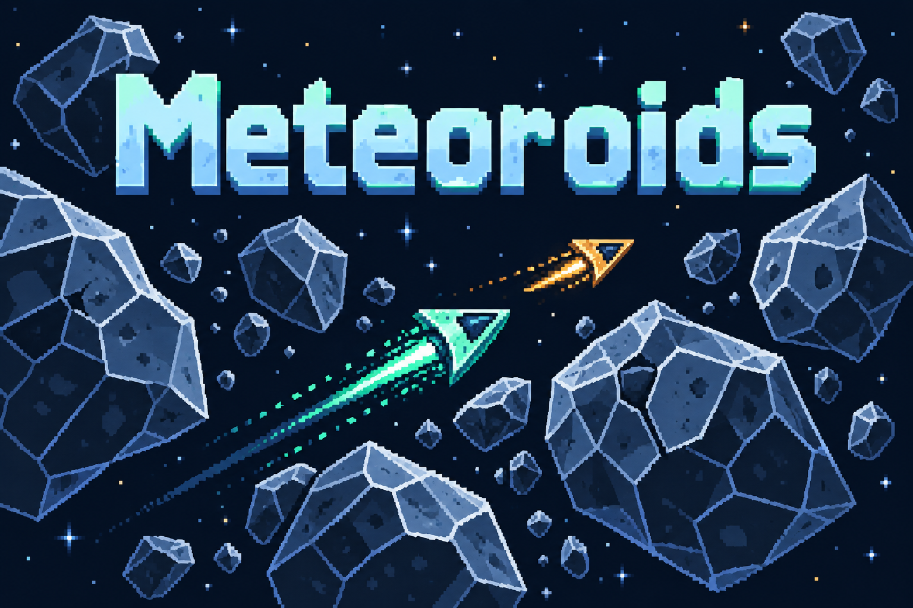
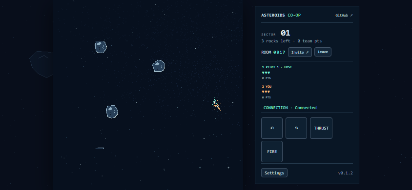
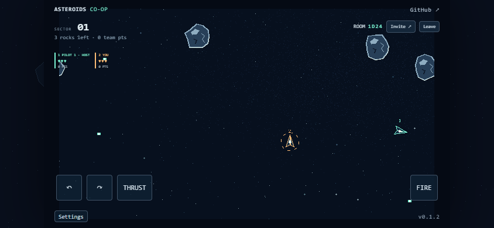

# Meteoroids

[](docs/game-branding.md)

An original pixel-art space survival game for **1–4 online cooperative players**, built with React and Babylon Lite WebGPU.

**[Play the live demo](https://samuelasherrivello-com-ai.github.io/babylon-lite-meteoroids-multiplayer/)** · [Releases](https://github.com/SamuelAsherRivello-com-ai/babylon-lite-meteoroids-multiplayer/releases) · [Game brief](docs/game-creation-prompt.md)



The screenshot shows the current layout, which is also deployed to the live demo.

Host a flight, copy the invitation, and let friends join during any wave. Guests can leave and rejoin; the creator stays the host. Each pilot has three lives for the whole run. Eliminated pilots spectate surviving teammates. When every connected pilot is eliminated, everyone returns together to wave one after five seconds.

Wave one always has three one-hit asteroids. Each breaks into two one-hit fragments that disappear when shot: nine hits clear the wave. Later waves increase health, speed, and the chance of splitting into three pieces, within entity and health caps. From wave two, difficulty samples the living roster at the start of the wave; mid-wave arrivals never reset or rescale the current rocks. Friendly fire is disabled.

## Controls

| Action | Keyboard | Touch |
| --- | --- | --- |
| Rotate | A / D or ← / → | ↶ / ↷ |
| Thrust | W or ↑ | THRUST |
| Fire | Space | FIRE |

Enable touch controls in Settings. Turn, thrust, and fire work simultaneously. Opening settings releases your input while the shared flight continues. Mute sound or reduce effects there; `?mute=true` always disables audio. Fullscreen is a checkbox in Settings. After a reset, release and press held controls again.

## Play and recovery

Use a current Chrome or Edge browser with WebGPU and hardware acceleration. The landscape app places the square game view on the left and the HUD, room actions, settings, and enabled touch controls on the right. The existing 640 × 360 world stays fully visible inside the game view, wraps at every edge, and keeps its logical bounds across resize, browser zoom, DPR, and fullscreen changes.

The host browser owns the world and must remain open and active, including while its pilot spectates. Host departure ends the room; there is no host migration. Browser suspension can stall gameplay and is shown to guests. The Vercel Hobby relay replaces sockets before their connection window expires without replacing the host world.

Guest refresh/rejoin in the **same browser tab** uses a private session-storage identity and preserves score, lives, and elimination. Closing the tab or clearing its storage loses that anonymous identity. A new tab is a new pilot. Reconnecting never displaces four already connected players. Invitations share only a public code; private recovery credentials never appear in URLs.

## Development

Node.js 24 and npm are used in CI. Run these commands from the repository root:

```sh
npm ci
npm test
npm run dev
npm run build
```

Open the Vite URL with `/babylon-lite-asteroids-multiplayer-clone/`. The app is in `asteroids/`; production output is `asteroids/dist/`. The production backend is `https://rmc-asteroids-coop.vercel.app`, pinned to [shared server v0.9.12](https://github.com/SamuelAsherRivello/rmc-colyseus-multiplayer-server/releases/tag/v0.9.12). The exact released client tarball is pinned in `package.json` and the lockfile. All backend hosting uses Vercel Hobby and first-party services; no paid hosting or third-party Redis is required.

The root `version.txt` is the version source. Dispatch the existing **Release** workflow on main to increment its patch, test/build, commit/tag, and publish. **Deploy live demo** builds and deploys GitHub Pages; dispatch it explicitly after a release bot commit. [Architecture and maintenance](docs/deep-dive-overview.md) explains module ownership and coordinated updates. [Source provenance](docs/source-provenance.md) records the template, shared skills, backend and collision decisions.

## Verification and limitations

Eight focused tests cover wrapped interpolation, input ownership/cancellation, pixel anchoring, complete landscape framing, the pinned wave-one/reset contract, stale-run rejection, and Pages paths. Independent headless Edge clients verified 1–4-player joins, keyboard movement/fire, mid-wave drop, same-tab refresh identity, host settings continuity, and spectator/reset/host loss. A delayed-WebSocket harness exercised approximately 150 ms RTT with ±50 ms jitter and simultaneous emulated touch. Natural shooting cleared wave one; explicit collision/lives fixtures covered the remaining transition edge cases. [Verification evidence](docs/verification.md) distinguishes those checks from public release verification.

Physical touchscreen hardware, every WebGPU adapter, and suspended-host browser policies are unverified. This is cooperative fixed-host gameplay, not a cheat-resistant server simulation: a malicious host can control its world. Free hosting remains subject to provider quotas. No account, matchmaking service, or persistence across host sessions is included.



## Credits

Original procedural artwork and synthesized event sounds; no commercial Asteroids assets copied. [Artwork sources](docs/artwork-provenance.md). Gameplay inspiration: [Asteroids (1979)](https://en.wikipedia.org/wiki/Asteroids_(video_game)). Created from [GitHub Repository Template](https://github.com/SamuelAsherRivello/github-repository-template), with [AI Skills Library](https://github.com/SamuelAsherRivello/ai-skills-library), [Babylon Lite](https://www.npmjs.com/package/@babylonjs/lite), and the [shared multiplayer server](https://github.com/SamuelAsherRivello/rmc-colyseus-multiplayer-server). Repository license: [LICENSE](LICENSE); imported skills retain their own notices.

## Original AI Prompt

Source conversation URL: [{original-ai-prompt-url}]({original-ai-prompt-url}) — **unverified**: no recoverable share URL was supplied. The original contains the Tetris label and dungeon template; the follow-ups below explicitly supersede those gameplay details. The interpreted [creation brief](docs/game-creation-prompt.md) is separate from this quotation.

<details>
<summary>Original request and consequential follow-ups</summary>

```text
update this template and fully populate it for a multiplayer 2d pixel perfect game of [https://en.wikipedia.org/wiki/Tetris](https://en.wikipedia.org/wiki/Asteroids_(video_game))

players can hot join and drop and the world is owned and simulated by the host with asteroids and a wave number. each wave is more complex with asteroids that require more shots before fracturing and each has higher chance to fracture in more pieces. level one is 3 asteroids each that fracture in 2 and each of those destroy without fracturing. when all asteroids are gone the wave advances when the player dies 3 times across any/all waves the game is over. if one player lives longer, the other can spectate until the game restarts at wave one with both of them after both die. the game can be playced with 1/2/3/4 players

$ai-skills-create-game

- Title: [Enter the Gungeon Clone]
- Type: [Multiplayer, online cooperative, 2–4 players. All human players cooperate on the same team.]
- World and camera:
  - [Create one 2D level approximately twice the viewport width and twice its height, giving it about four times the area of one screen.]
  - [The level may be tile-based or use freely placed artwork and geometry.]
  - [Use a top-down orthographic camera that smoothly follows the local player and stays within the level boundaries.]
- Core loop: [Cooperate to survive increasingly difficult enemy waves, dodge bullet patterns, collect loot, and choose weapon upgrades between waves. Defeat a boss every five waves. The run ends when the entire team is down.]
- Controls: [WASD movement, mouse aiming, left-click shooting, and Space to dodge roll with a short cooldown and brief invulnerability.]
- Cooperative mechanics:
  - [Create or join a room using a shareable room code, then ready up together.]
  - [Revive downed teammates, share upgrade rewards, and disable friendly fire.]
  - [Scale enemy counts and difficulty with the number of active players.]
  - [Show directional indicators for teammates outside the local camera view.]
- Look and feel:
  - [Original pixel-art dungeon scenery with stone floors, destructible props, and readable cover.]
  - [Distinct player colors, expressive enemies, bright projectiles, punchy muzzle flashes, and clear hit feedback.]
  - [Keep enemy bullets visually distinct from friendly shots. Show player health, teammate status, current wave, remaining enemies, and dodge cooldown.]
- Gameplay requirements:
  - [Include three starting weapons with distinct firing patterns and meaningful upgrades.]
  - [Include enemies that chase, fire aimed shots, and emit radial bullet patterns.]
  - [Provide short breaks between waves for upgrades and a team restart option after defeat.]
- Multiplayer server and smoothness:
  - [Use https://github.com/SamuelAsherRivello/rmc-colyseus-multiplayer-server or my writable fork: <fork URL, if applicable>.]
  - [Automatically update the selected server repository with the room logic and synchronized state required by this game.]
  - [Make the server authoritative for movement validation, combat, enemy spawning, damage, loot, revives, and wave progression.]
  - [Use supported Colyseus prediction features where available, or implement suitable client-side prediction, server reconciliation, and interpolation.]
  - [Respond immediately to local movement and dodge inputs. Smooth reconciliation corrections and drive the camera from the predicted local character position to avoid visible jitter.]
  - [Interpolate remote players and enemies. Use immediate local animations, muzzle flashes, and cosmetic effects while reconciling gameplay outcomes with the server.]
  - [Use deterministic projectile motion or other bandwidth-efficient synchronization where appropriate.]
  - [Prioritize a smooth, consistent experience for every player over action density. If synchronization struggles, reduce concurrent bullets, enemies, spawn rates, and firing rates.]
  - [Handle disconnects and reconnects gracefully.]
  - [Verify with at least two browser clients, including simulated latency and jitter. Check responsive local movement, stable camera tracking, smooth remote motion, and consistent combat outcomes.]
- Inspiration links:
  - [https://store.steampowered.com/app/311690/Enter_the_Gungeon/]
- Inspiration screenshots: [Attach reference screenshots here.]
- Originality requirement: [Keep the requested project title, but create original artwork, sounds, characters, weapons, UI, and level layouts; use the reference only for gameplay and visual inspiration.]
```

Follow-ups (quoted separately):

```text
I meant Asteroids, not Tetris. Rewrite and fully populate the template as a ready-to-copy game creation prompt with all my multiplayer, wave, lives, and spectator requirements. Don’t implement it yet. https://en.wikipedia.org/wiki/Asteroids_(video_game)

1 hot join and hot drop. the multplayer server has that feature. so people can join/ddrop mid level. except he host

stop there.

Now read the $ai-skills-create-game skill and prepare a $openspec-propose about how you will use the template and multiplayer server to meet the needs of the requested prompt. This allows for propose to think more heavily before implemtation.

You have $github access and the multiplayer server has the vercel credentials. there is no reason to stop for any reason until the game is done, and shipped to the readme as a live demo.

continue

you are required to use the free plan of vercel. stop asking for alternatives

when you spawn browser game windows, can you do it minimized or headless and still continue your work? that will be less disruptive to me
```

Repeated numeric interview replies selected options; the resolved behavior is recorded in the OpenSpec design and creation brief, rather than inventing missing question text here.

</details>

For a credential-free local backend override, set the build environment variable `VITE_ASTEROIDS_ENDPOINT` to your own local shared-server URL before running Vite. Production defaults to the verified HTTPS endpoint; no service credential is a client setting.


Formatting used: `npx --yes prettier@3.6.2 --write "asteroids/src/**/*.{js,jsx,css}" "asteroids/test/*.mjs" vite.config.js package.json`. The creation quality gate produced [the final triage packet](docs/triage/analyze/2026-10-11-02/overview.md): Standardization 94/100, Architecture 85/100; clock/transport substitution and UI decomposition remain deferred architecture candidates.


